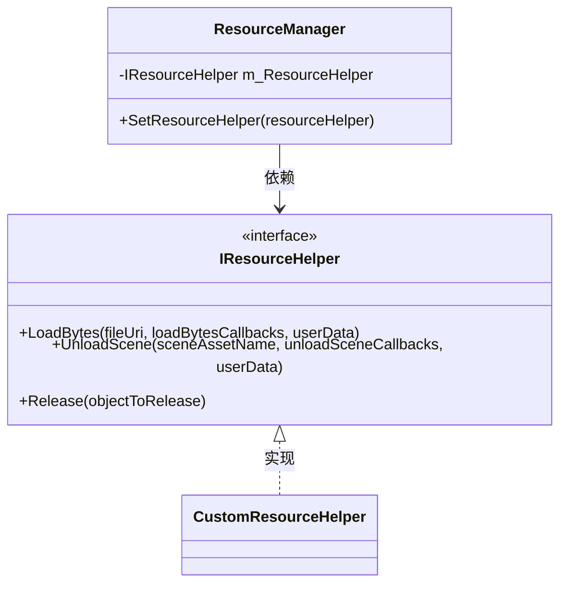
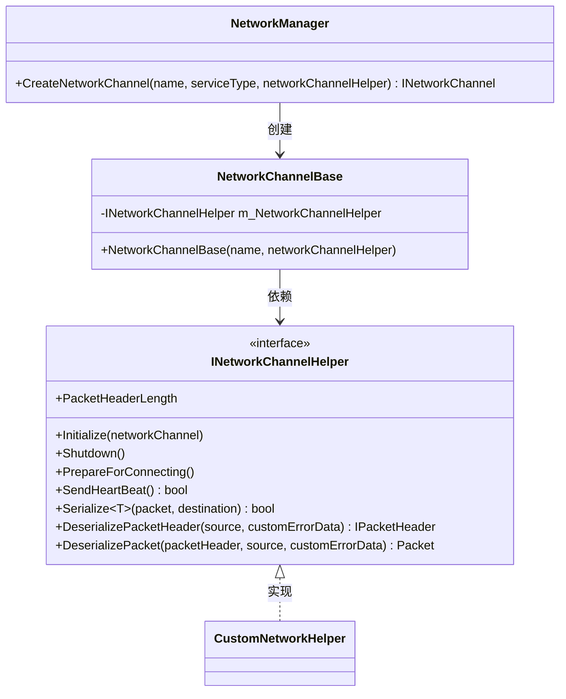
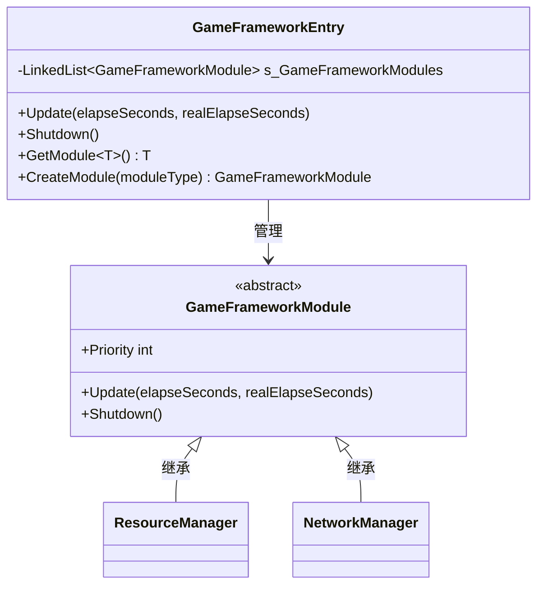
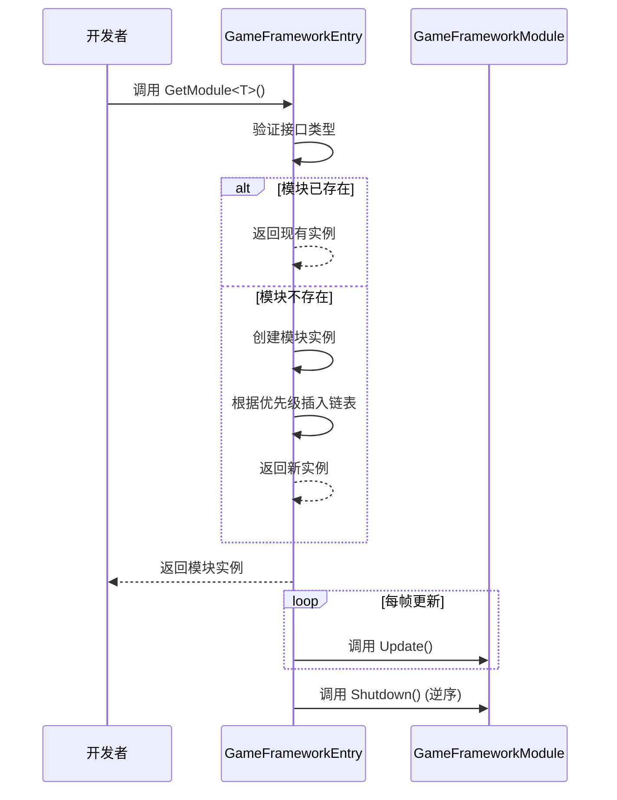
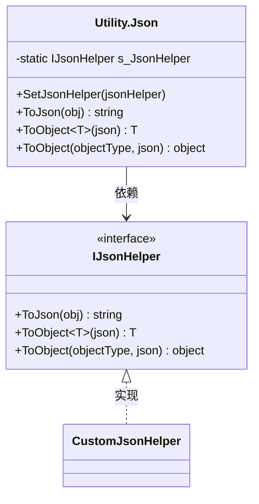
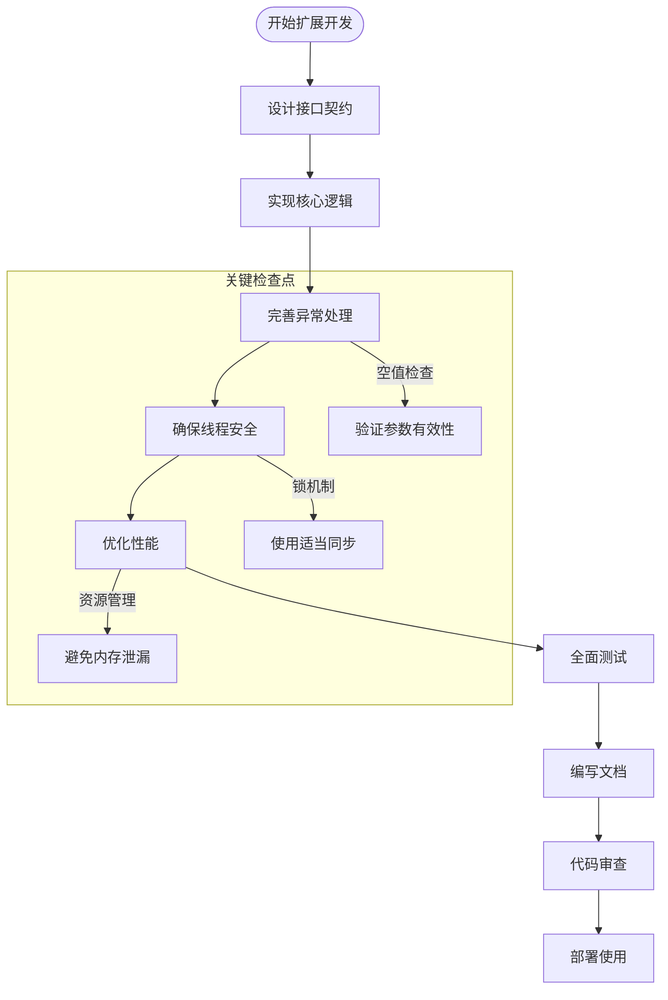

# 框架扩展开发

<cite>
**本文档引用文件**   
- [IResourceHelper.cs](file://GameFramework/Resource/IResourceHelper.cs)
- [INetworkChannelHelper.cs](file://GameFramework/Network/INetworkChannelHelper.cs)
- [GameFrameworkModule.cs](file://GameFramework/Base/GameFrameworkModule.cs)
- [GameFrameworkEntry.cs](file://GameFramework/Base/GameFrameworkEntry.cs)
- [IJsonHelper.cs](file://GameFramework/Utility/Utility.Json.IJsonHelper.cs)
- [Utility.Json.cs](file://GameFramework/Utility/Utility.Json.cs)
- [ResourceManager.cs](file://GameFramework/Resource/ResourceManager.cs)
- [NetworkManager.cs](file://GameFramework/Network/NetworkManager.cs)
</cite>

## 目录
1. [引言](#引言)
2. [核心接口扩展机制](#核心接口扩展机制)
3. [模块注册与生命周期管理](#模块注册与生命周期管理)
4. [通用功能扩展](#通用功能扩展)
5. [代码规范与兼容性](#代码规范与兼容性)
6. [结论](#结论)

## 引言
本文档旨在为高级开发者提供框架扩展开发的全面指导。重点讲解如何通过实现核心接口（如IResourceHelper、INetworkChannelHelper）进行底层行为定制，解析GameFrameworkModule的模块注册机制，以及通过IJsonHelper示例展示通用功能的扩展方法。文档还包含扩展开发的代码规范、接口设计原则与兼容性注意事项，确保扩展不影响框架稳定性。

## 核心接口扩展机制

### 资源管理扩展 (IResourceHelper)
`IResourceHelper` 接口是资源管理的核心扩展点，允许开发者自定义资源加载、场景卸载和资源释放行为。通过实现此接口，可以完全控制框架的资源加载流程。

**图示来源**
- [IResourceHelper.cs](file://GameFramework/Resource/IResourceHelper.cs#L12-L35)
- [ResourceManager.cs](file://GameFramework/Resource/ResourceManager.cs#L1037-L1073)

**扩展要点：**
- `LoadBytes` 方法用于从指定文件路径加载数据流，支持异步操作和用户自定义数据传递
- `UnloadScene` 方法负责场景卸载，需提供卸载回调函数集
- `Release` 方法用于释放资源对象，确保内存管理的正确性
- 必须在添加加载资源代理辅助器之前设置资源辅助器，否则会抛出异常

**本节来源**
- [IResourceHelper.cs](file://GameFramework/Resource/IResourceHelper.cs#L12-L35)
- [ResourceManager.cs](file://GameFramework/Resource/ResourceManager.cs#L1037-L1073)

### 网络通信扩展 (INetworkChannelHelper)
`INetworkChannelHelper` 接口是网络通信的扩展核心，允许开发者自定义网络消息的序列化、反序列化和心跳机制。

**图示来源**
- [INetworkChannelHelper.cs](file://GameFramework/Network/INetworkChannelHelper.cs#L14-L71)
- [NetworkManager.cs](file://GameFramework/Network/NetworkManager.cs#L210-L239)
- [NetworkChannelBase.cs](file://GameFramework/Network/NetworkManager.NetworkChannelBase.cs#L45-L75)

**扩展要点：**
- `PacketHeaderLength` 属性定义消息包头长度，必须为非负值
- `Initialize` 方法在创建网络频道时被调用，用于初始化辅助器
- `Serialize` 和 `Deserialize` 方法分别负责消息的序列化和反序列化
- `SendHeartBeat` 方法用于发送心跳消息包，维持网络连接
- 创建网络频道时会验证辅助器的有效性，确保包头长度合法

**本节来源**
- [INetworkChannelHelper.cs](file://GameFramework/Network/INetworkChannelHelper.cs#L14-L71)
- [NetworkManager.cs](file://GameFramework/Network/NetworkManager.cs#L210-L239)
- [NetworkChannelBase.cs](file://GameFramework/Network/NetworkManager.NetworkChannelBase.cs#L45-L75)

## 模块注册与生命周期管理

### GameFrameworkModule 抽象类
`GameFrameworkModule` 是所有游戏框架模块的抽象基类，定义了模块的生命周期和优先级机制。

**图示来源**
- [GameFrameworkModule.cs](file://GameFramework/Base/GameFrameworkModule.cs#L12-L37)
- [GameFrameworkEntry.cs](file://GameFramework/Base/GameFrameworkEntry.cs#L101-L130)

### 模块注册流程
框架通过 `GameFrameworkEntry` 类管理所有模块的注册和生命周期。模块注册遵循优先级排序机制，确保高优先级模块优先轮询。

**图示来源**
- [GameFrameworkEntry.cs](file://GameFramework/Base/GameFrameworkEntry.cs#L32-L60)
- [GameFrameworkEntry.cs](file://GameFramework/Base/GameFrameworkEntry.cs#L93-L130)

**关键特性：**
- 模块优先级 (`Priority`) 决定了轮询顺序和关闭顺序
- 高优先级模块先轮询，后关闭
- 模块通过链表管理，按优先级排序插入
- 关闭时按逆序调用 `Shutdown` 方法，确保依赖关系正确处理
- 所有模块的更新由 `GameFrameworkEntry.Update` 统一调度

**本节来源**
- [GameFrameworkModule.cs](file://GameFramework/Base/GameFrameworkModule.cs#L12-L37)
- [GameFrameworkEntry.cs](file://GameFramework/Base/GameFrameworkEntry.cs#L32-L60)
- [GameFrameworkEntry.cs](file://GameFramework/Base/GameFrameworkEntry.cs#L93-L130)

## 通用功能扩展

### JSON 功能扩展 (IJsonHelper)
`IJsonHelper` 接口是框架通用功能扩展的典型示例，展示了如何通过策略模式替换或增强框架的内置功能。

**图示来源**
- [IJsonHelper.cs](file://GameFramework/Utility/Utility.Json.IJsonHelper.cs#L18-L42)
- [Utility.Json.cs](file://GameFramework/Utility/Utility.Json.cs#L0-L119)

**扩展流程：**
1. 实现 `IJsonHelper` 接口，提供自定义的 JSON 序列化和反序列化逻辑
2. 调用 `Utility.Json.SetJsonHelper()` 方法注册自定义辅助器
3. 框架后续的 JSON 操作将使用自定义实现

**注意事项：**
- 必须在首次使用 JSON 功能前设置辅助器
- 如果未设置辅助器，调用 JSON 方法会抛出异常
- 异常处理机制确保原始异常信息不被丢失
- 支持泛型和非泛型两种反序列化方式，提供灵活性

**本节来源**
- [IJsonHelper.cs](file://GameFramework/Utility/Utility.Json.IJsonHelper.cs#L18-L42)
- [Utility.Json.cs](file://GameFramework/Utility/Utility.Json.cs#L0-L119)

## 代码规范与兼容性

### 扩展开发规范
为确保扩展的安全性和稳定性，开发者应遵循以下代码规范：

**图示来源**
- [IResourceHelper.cs](file://GameFramework/Resource/IResourceHelper.cs#L12-L35)
- [INetworkChannelHelper.cs](file://GameFramework/Network/INetworkChannelHelper.cs#L14-L71)
- [IJsonHelper.cs](file://GameFramework/Utility/Utility.Json.IJsonHelper.cs#L18-L42)

### 兼容性注意事项
为确保扩展不影响框架稳定性，需注意以下兼容性问题：

1. **接口契约保持**：扩展实现必须严格遵守接口定义的契约，包括参数类型、返回值和异常行为
2. **线程安全**：网络和资源操作可能涉及多线程，实现时需确保线程安全
3. **异常处理**：正确处理异常情况，避免框架崩溃
4. **资源管理**：及时释放资源，防止内存泄漏
5. **版本兼容**：考虑框架版本升级的兼容性，避免使用内部API
6. **性能影响**：评估扩展对框架性能的影响，避免成为性能瓶颈

**本节来源**
- [IResourceHelper.cs](file://GameFramework/Resource/IResourceHelper.cs#L12-L35)
- [INetworkChannelHelper.cs](file://GameFramework/Network/INetworkChannelHelper.cs#L14-L71)
- [IJsonHelper.cs](file://GameFramework/Utility/Utility.Json.IJsonHelper.cs#L18-L42)

## 结论
本文档详细介绍了框架扩展开发的核心机制，包括接口扩展、模块注册和通用功能替换。通过实现 `IResourceHelper` 和 `INetworkChannelHelper` 等接口，开发者可以深度定制框架行为。`GameFrameworkModule` 的优先级机制确保了模块生命周期的有序管理。`IJsonHelper` 的示例展示了如何安全地替换框架的通用功能。遵循文档中的代码规范和兼容性注意事项，可以确保扩展的安全性和稳定性，为框架的持续演进提供坚实基础。