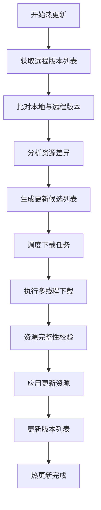
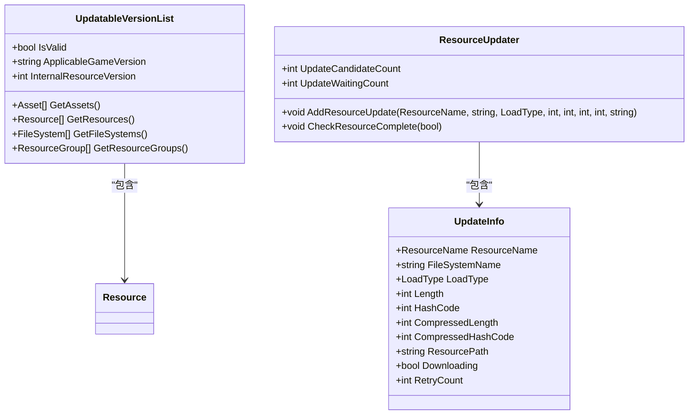
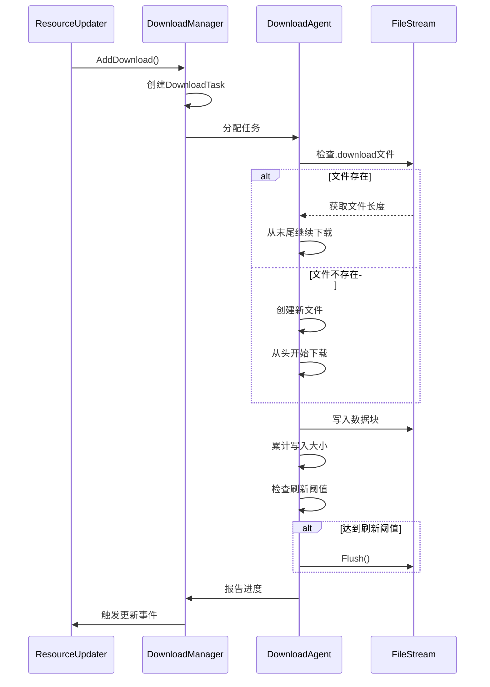
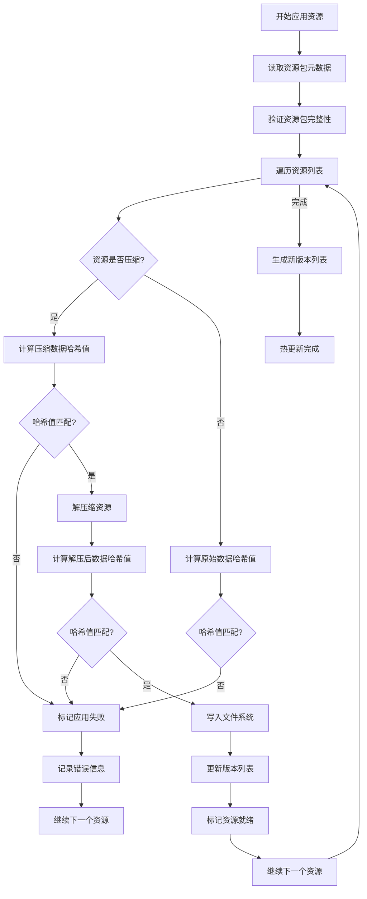
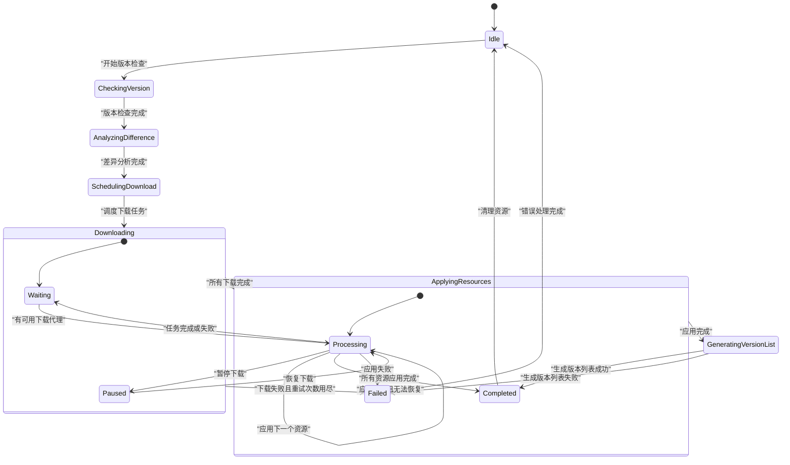

# 热更新机制

<cite>
**本文档引用文件**  
- [ResourceManager.ResourceUpdater.cs](file://GameFramework/Resource/ResourceManager.ResourceUpdater.cs)
- [UpdatableVersionList.cs](file://GameFramework/Resource/UpdatableVersionList.cs)
- [DownloadManager.cs](file://GameFramework/Download/DownloadManager.cs)
- [DownloadManager.DownloadAgent.cs](file://GameFramework/Download/DownloadManager.DownloadAgent.cs)
- [ResourceManager.ResourceUpdater.ApplyInfo.cs](file://GameFramework/Resource/ResourceManager.ResourceUpdater.ApplyInfo.cs)
- [ResourceManager.ResourceUpdater.UpdateInfo.cs](file://GameFramework/Resource/ResourceManager.ResourceUpdater.UpdateInfo.cs)
- [DownloadManager.DownloadTask.cs](file://GameFramework/Download/DownloadManager.DownloadTask.cs)
</cite>

## 目录
1. [简介](#简介)
2. [热更新流程概览](#热更新流程概览)
3. [版本列表比对与资源差异分析](#版本列表比对与资源差异分析)
4. [下载任务调度机制](#下载任务调度机制)
5. [资源应用与校验流程](#资源应用与校验流程)
6. [热更新状态机](#热更新状态机)
7. [关键回调事件说明](#关键回调事件说明)
8. [异常处理方案](#异常处理方案)
9. [性能优化建议](#性能优化建议)

## 简介
本文档全面解析Unity游戏框架中的热更新完整流程，涵盖从版本列表比对、资源差异分析、下载任务调度到资源应用与校验的全链路实现。重点阐述ResourceManager.ResourceUpdater与UpdatableVersionList的交互逻辑，详细说明增量更新、断点续传、资源包加载等关键技术细节。结合DownloadManager的任务管理机制，深入剖析多线程下载、带宽控制与错误重试策略。通过状态机图解、关键回调事件说明及异常处理方案，帮助开发者构建稳定可靠的更新系统。

## 热更新流程概览
热更新流程主要由三个核心组件协同工作：ResourceManager.ResourceUpdater负责整体更新逻辑的协调与状态管理，UpdatableVersionList提供远程版本资源列表的数据结构，DownloadManager则负责具体的下载任务执行。整个流程始于本地版本与远程版本的比对，通过分析差异确定需要更新的资源，然后调度下载任务，最后将下载的资源应用到本地并进行完整性校验。



**图示来源**  
- [ResourceManager.ResourceUpdater.cs](file://GameFramework/Resource/ResourceManager.ResourceUpdater.cs#L57-L80)
- [UpdatableVersionList.cs](file://GameFramework/Resource/UpdatableVersionList.cs#L39-L48)
- [DownloadManager.cs](file://GameFramework/Download/DownloadManager.cs#L28-L79)

## 版本列表比对与资源差异分析
版本列表比对是热更新的第一步，通过比较本地存储的版本信息与从服务器获取的可更新模式版本资源列表（UpdatableVersionList），确定需要更新的资源集合。UpdatableVersionList结构体包含了适配的游戏版本号、内部资源版本号以及包含的资源、文件系统和资源组等信息。

资源差异分析通过ResourceManager.ResourceUpdater的AddResourceUpdate方法实现，该方法将需要更新的资源信息添加到候选更新字典（m_UpdateCandidateInfo）中。分析过程会检查资源的哈希值、大小等元数据，只有当这些信息与本地存储的不一致时，才会将资源标记为需要更新。



**图示来源**  
- [UpdatableVersionList.cs](file://GameFramework/Resource/UpdatableVersionList.cs#L39-L48)
- [ResourceManager.ResourceUpdater.cs](file://GameFramework/Resource/ResourceManager.ResourceUpdater.cs#L57-L80)
- [ResourceManager.ResourceUpdater.UpdateInfo.cs](file://GameFramework/Resource/ResourceManager.ResourceUpdater.UpdateInfo.cs#L0-L27)

**本节来源**  
- [UpdatableVersionList.cs](file://GameFramework/Resource/UpdatableVersionList.cs#L39-L48)
- [ResourceManager.ResourceUpdater.cs](file://GameFramework/Resource/ResourceManager.ResourceUpdater.cs#L57-L80)
- [ResourceManager.ResourceUpdater.UpdateInfo.cs](file://GameFramework/Resource/ResourceManager.ResourceUpdater.UpdateInfo.cs#L0-L27)

## 下载任务调度机制
下载任务调度由DownloadManager和ResourceManager.ResourceUpdater协同完成。ResourceUpdater通过SetDownloadManager方法与DownloadManager建立连接，并在Update方法中根据可用代理数量调度下载任务。DownloadManager使用任务池模式管理下载代理，支持多线程并发下载。

下载任务的创建通过AddDownload方法实现，该方法接受下载路径、下载URI、标签、优先级等参数。每个下载任务（DownloadTask）包含状态管理、超时控制和缓冲区刷新机制。断点续传功能通过检查临时下载文件（.download）的存在来实现，若文件存在则从文件末尾继续下载。



**图示来源**  
- [ResourceManager.ResourceUpdater.cs](file://GameFramework/Resource/ResourceManager.ResourceUpdater.cs#L57-L80)
- [DownloadManager.cs](file://GameFramework/Download/DownloadManager.cs#L28-L79)
- [DownloadManager.DownloadAgent.cs](file://GameFramework/Download/DownloadManager.DownloadAgent.cs#L12-L373)

**本节来源**  
- [ResourceManager.ResourceUpdater.cs](file://GameFramework/Resource/ResourceManager.ResourceUpdater.cs#L57-L80)
- [DownloadManager.cs](file://GameFramework/Download/DownloadManager.cs#L28-L79)
- [DownloadManager.DownloadAgent.cs](file://GameFramework/Download/DownloadManager.DownloadAgent.cs#L12-L373)

## 资源应用与校验流程
资源应用与校验是热更新的最后阶段，确保下载的资源完整且正确。ResourceUpdater通过ApplyResources方法应用资源包，该方法首先验证资源包的完整性，然后逐个应用包内的资源。每个资源的校验包括哈希值校验、大小校验和解压缩校验。

对于压缩资源，系统会先计算下载文件的CRC32哈希值与预期的压缩哈希值进行比对，通过后再进行解压缩操作。解压后再次计算原始数据的哈希值与预期哈希值进行比对。对于加密资源，还会在特定字节范围内进行哈希校验。校验通过的资源会被标记为就绪状态，并更新读写区版本列表。



**图示来源**  
- [ResourceManager.ResourceUpdater.cs](file://GameFramework/Resource/ResourceManager.ResourceUpdater.cs#L57-L80)
- [ResourceManager.ResourceUpdater.ApplyInfo.cs](file://GameFramework/Resource/ResourceManager.ResourceUpdater.ApplyInfo.cs#L0-L29)
- [Utility.Verifier.cs](file://GameFramework/Utility/Utility.Verifier.cs)

**本节来源**  
- [ResourceManager.ResourceUpdater.cs](file://GameFramework/Resource/ResourceManager.ResourceUpdater.cs#L57-L80)
- [ResourceManager.ResourceUpdater.ApplyInfo.cs](file://GameFramework/Resource/ResourceManager.ResourceUpdater.ApplyInfo.cs#L0-L29)

## 热更新状态机
热更新过程可以抽象为一个状态机，包含多个关键状态和转换条件。状态机由ResourceManager.ResourceUpdater维护，通过Update方法在每帧进行状态轮询。主要状态包括：等待应用资源、等待下载资源、下载中、应用中、更新完成和更新失败。

状态转换由事件驱动，如下载开始、下载更新、下载成功、下载失败等事件会触发相应的状态转换。例如，当所有下载任务完成后，状态机会转换到应用资源阶段；当资源应用完成后，会触发更新完成事件。状态机还处理并发控制，确保同一时间只有一个资源包在应用，只有一个资源组在更新。



**图示来源**  
- [ResourceManager.ResourceUpdater.cs](file://GameFramework/Resource/ResourceManager.ResourceUpdater.cs#L57-L80)
- [DownloadManager.cs](file://GameFramework/Download/DownloadManager.cs#L28-L79)

## 关键回调事件说明
热更新系统提供了一系列关键回调事件，用于通知外部系统更新过程中的重要状态变化。这些事件通过委托（GameFrameworkAction）实现，包括资源应用开始、资源应用成功、资源应用失败、资源应用完成、资源更新开始、资源更新进度、资源更新成功、资源更新失败、资源更新完成和资源更新全部完成。

事件参数包含了丰富的上下文信息，如资源名称、下载路径、下载URI、当前进度、错误信息等。开发者可以通过订阅这些事件来实现更新进度显示、错误提示、更新完成通知等UI功能。事件系统采用观察者模式，确保事件发布与订阅的解耦。

| 事件名称 | 参数 | 触发时机 |
|---------|------|---------|
| ResourceApplyStart | resourcePackPath, count, totalLength | 开始应用资源包时 |
| ResourceApplySuccess | resourceName, applyPath, resourcePackPath, length, compressedLength | 单个资源应用成功时 |
| ResourceApplyFailure | resourceName, resourcePackPath, errorMessage | 单个资源应用失败时 |
| ResourceApplyComplete | resourcePackPath, result | 整个资源包应用完成时 |
| ResourceUpdateStart | resourceName, downloadPath, downloadUri, currentLength, compressedLength, retryCount | 开始下载单个资源时 |
| ResourceUpdateChanged | resourceName, downloadPath, downloadUri, currentLength, compressedLength | 下载进度更新时 |
| ResourceUpdateSuccess | resourceName, downloadPath, downloadUri, length, compressedLength | 单个资源下载成功时 |
| ResourceUpdateFailure | resourceName, downloadUri, retryCount, totalRetryCount, errorMessage | 单个资源下载失败时 |
| ResourceUpdateComplete | resourceGroup, result | 整个资源组更新完成时 |
| ResourceUpdateAllComplete | 无参数 | 所有更新任务完成时 |

**本节来源**  
- [ResourceManager.ResourceUpdater.cs](file://GameFramework/Resource/ResourceManager.ResourceUpdater.cs#L57-L80)
- [ResourceManager.cs](file://GameFramework/Resource/ResourceManager.cs#L2472-L2570)

## 异常处理方案
热更新系统实现了完善的异常处理机制，确保在各种异常情况下能够优雅地恢复或降级。主要异常包括网络中断、磁盘空间不足、文件损坏、权限不足等。系统采用重试策略应对临时性错误，通过UpdateRetryCount属性配置最大重试次数，默认为3次。

对于下载失败，系统会在OnDownloadFailure回调中处理，根据重试次数决定是重新调度下载任务还是标记为永久失败。资源应用过程中的异常会通过ResourceApplyFailure事件通知，并设置m_FailureFlag标志。系统还实现了资源包应用的原子性，通过临时文件和原子移动操作确保不会留下不完整的中间状态。

```mermaid
flowchart TD
    A[发生异常] --> B{异常类型}
    B -->|网络相关| C[检查重试次数]
    B -->|文件系统相关| D[检查磁盘空间]
    B -->|数据完整性| E[验证哈希值]
    
    C -->|未达上限| F[增加重试计数]
    F --> G[重新调度下载]
    C -->|已达上限| H[标记永久失败]
    
    D -->|空间不足| I[清理临时文件]
    I --> J[通知用户清理空间]
    D -->|权限问题| K[请求权限]
    
    E -->|哈希不匹配| L[删除损坏文件]
    L --> M[重新下载]
    E -->|解压失败| N[验证压缩格式]
    N --> O[重新下载]
    
    H --> P