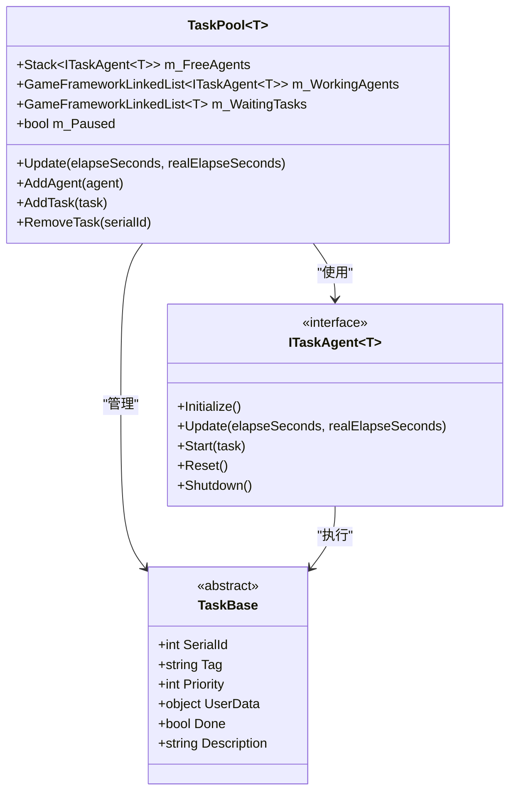
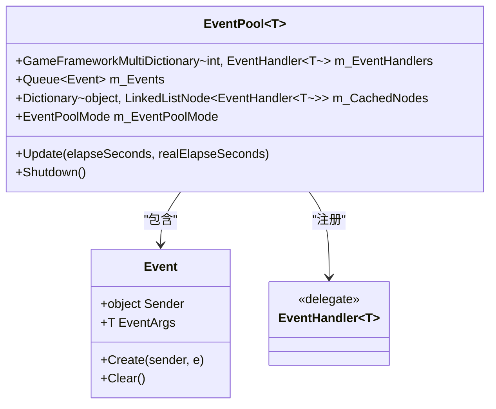
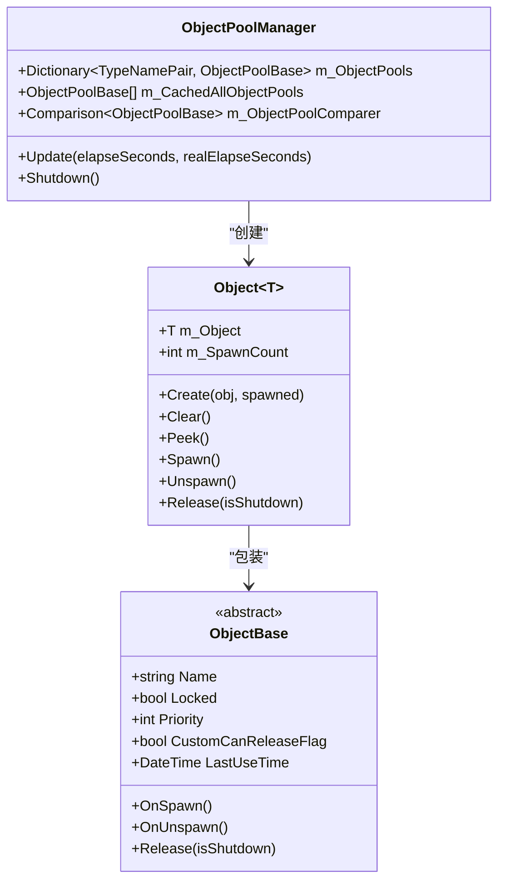
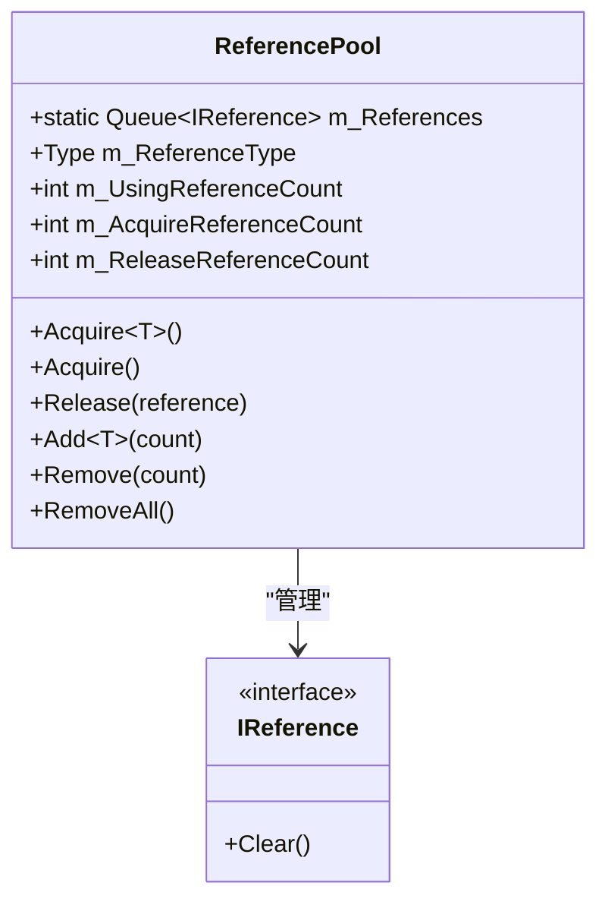
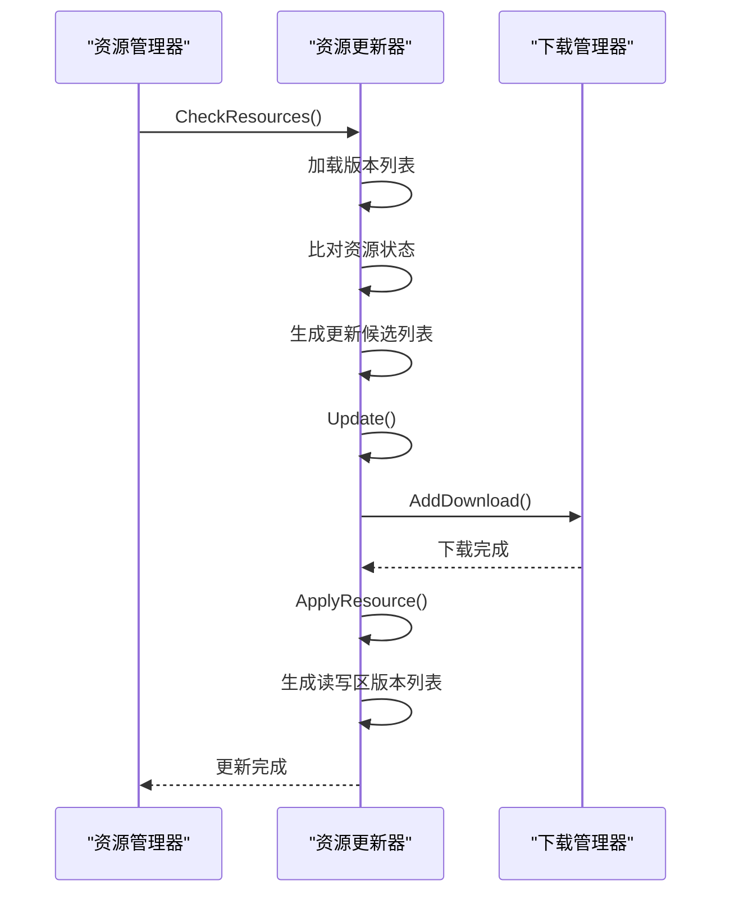
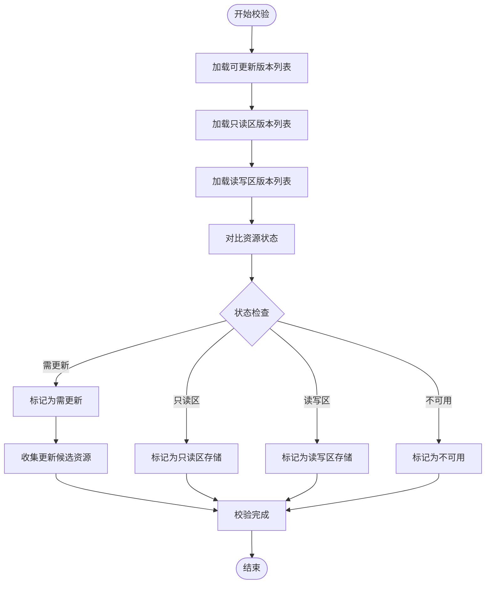
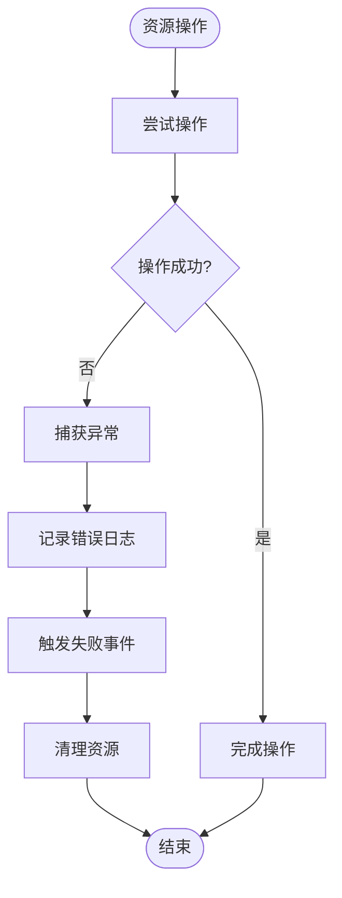
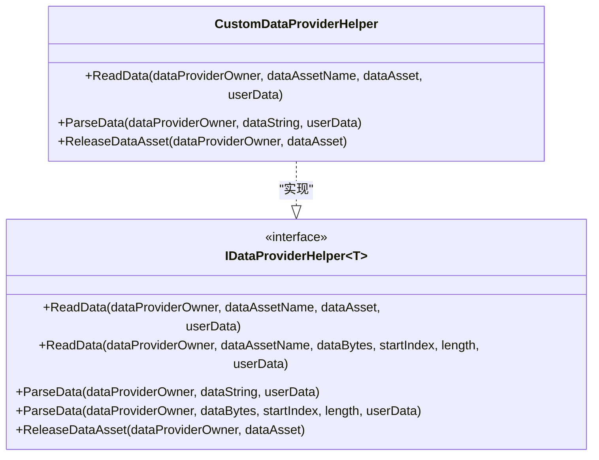
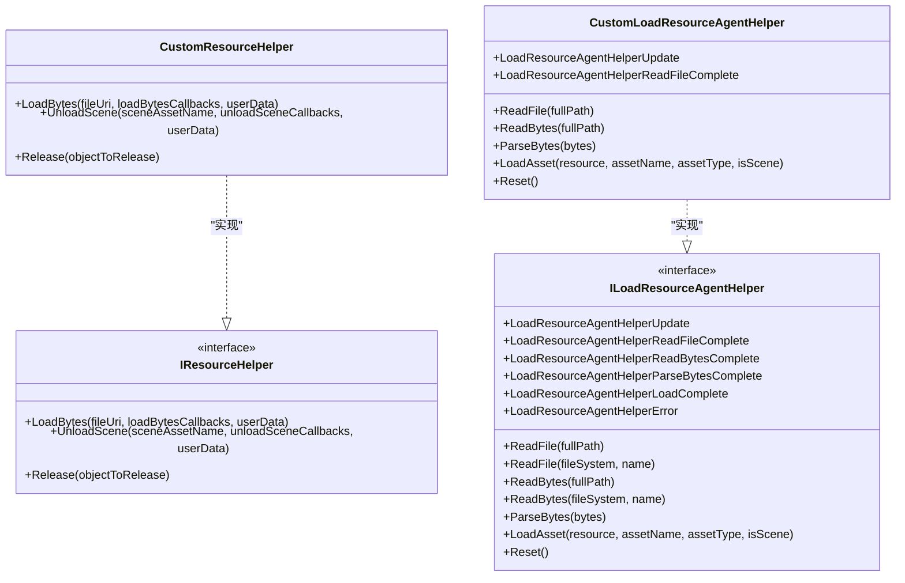

# 高级主题

<cite>
**本文档中引用的文件**  
- [ReferencePool.ReferenceCollection.cs](file://GameFramework/Base/ReferencePool/ReferencePool.ReferenceCollection.cs)
- [ObjectPoolManager.Object.cs](file://GameFramework/ObjectPool/ObjectPoolManager.Object.cs)
- [TaskPool.cs](file://GameFramework/Base/TaskPool/TaskPool.cs)
- [EventPool.Event.cs](file://GameFramework/Base/EventPool/EventPool.Event.cs)
- [IDataProviderHelper.cs](file://GameFramework/Base/DataProvider/IDataProviderHelper.cs)
- [IResourceHelper.cs](file://GameFramework/Resource/IResourceHelper.cs)
- [ILoadResourceAgentHelper.cs](file://GameFramework/Resource/ILoadResourceAgentHelper.cs)
- [IResourceManager.cs](file://GameFramework/Resource/IResourceManager.cs)
- [GameFrameworkLog.ILogHelper.cs](file://GameFramework/Base/Log/GameFrameworkLog.ILogHelper.cs)
- [DebuggerManager.DebuggerWindowGroup.cs](file://GameFramework/Debugger/DebuggerManager.DebuggerWindowGroup.cs)
- [ResourceManager.ResourceUpdater.cs](file://GameFramework/Resource/ResourceManager.ResourceUpdater.cs)
- [ResourceManager.ResourceChecker.cs](file://GameFramework/Resource/ResourceManager.ResourceChecker.cs)
- [Utility.Verifier.Crc32.cs](file://GameFramework/Utility/Utility.Verifier.Crc32.cs)
- [Utility.Compression.cs](file://GameFramework/Utility/Utility.Compression.cs)
- [GameFrameworkLog.cs](file://GameFramework/Base/Log/GameFrameworkLog.cs)
- [DebuggerManager.cs](file://GameFramework/Debugger/DebuggerManager.cs)
</cite>

## 目录
1. [引言](#引言)
2. [性能优化策略](#性能优化策略)
3. [内存管理技巧](#内存管理技巧)
4. [热更新完整方案](#热更新完整方案)
5. [异常处理机制](#异常处理机制)
6. [框架扩展开发](#框架扩展开发)
7. [资源更新流程分析](#资源更新流程分析)
8. [GC优化实践](#gc优化实践)
9. [自定义Helper实现方式](#自定义helper实现方式)
10. [性能剖析工具使用方法](#性能剖析工具使用方法)
11. [常见性能瓶颈解决方案](#常见性能瓶颈解决方案)
12. [框架定制最佳实践](#框架定制最佳实践)
13. [结论](#结论)

## 引言
本文档深入探讨GameFramework框架的高级使用主题，涵盖性能优化、内存管理、热更新机制、异常处理和框架扩展等核心领域。通过分析框架内部实现机制，为高级开发者提供充分发挥框架潜力的指导方案。

## 性能优化策略

### 任务池优化
框架通过`TaskPool<T>`类实现任务调度优化，采用工作队列与代理池机制，有效管理异步任务执行。任务代理在空闲与工作状态间流转，避免频繁创建销毁开销。

**Diagram sources**
- [TaskPool.cs](file://GameFramework/Base/TaskPool/TaskPool.cs#L15-L442)

**Section sources**
- [TaskPool.cs](file://GameFramework/Base/TaskPool/TaskPool.cs#L15-L442)

### 事件池优化
`EventPool<T>`通过对象池技术管理事件对象，避免GC压力。事件节点复用机制确保事件处理的高效性，同时支持事件处理模式配置。

**Diagram sources**
- [EventPool.Event.cs](file://GameFramework/Base/EventPool/EventPool.Event.cs#L9-L55)
- [EventPool.cs](file://GameFramework/Base/EventPool/EventPool.cs#L29-L37)

**Section sources**
- [EventPool.Event.cs](file://GameFramework/Base/EventPool/EventPool.Event.cs#L9-L55)
- [EventPool.cs](file://GameFramework/Base/EventPool/EventPool.cs#L29-L37)

## 内存管理技巧

### 对象池管理
`ObjectPoolManager`实现精细化的对象池管理，支持不同类型对象的池化管理。内部对象包装机制确保对象状态的正确维护和生命周期管理。

**Diagram sources**
- [ObjectPoolManager.Object.cs](file://GameFramework/ObjectPool/ObjectPoolManager.Object.cs#L11-L194)
- [ObjectPoolManager.cs](file://GameFramework/ObjectPool/ObjectPoolManager.cs#L28-L33)

**Section sources**
- [ObjectPoolManager.Object.cs](file://GameFramework/ObjectPool/ObjectPoolManager.Object.cs#L11-L194)
- [ObjectPoolManager.cs](file://GameFramework/ObjectPool/ObjectPoolManager.cs#L28-L33)

### 引用池管理
`ReferencePool`通过`ReferenceCollection`实现引用对象的池化管理，支持线程安全的引用获取与释放操作，有效减少内存分配频率。

**Diagram sources**
- [ReferencePool.ReferenceCollection.cs](file://GameFramework/Base/ReferencePool/ReferencePool.ReferenceCollection.cs#L12-L200)

**Section sources**
- [ReferencePool.ReferenceCollection.cs](file://GameFramework/Base/ReferencePool/ReferencePool.ReferenceCollection.cs#L12-L200)

## 热更新完整方案

### 资源更新流程
资源更新器`ResourceUpdater`实现完整的热更新流程，包括资源校验、下载、应用和版本列表生成等关键步骤。

**Diagram sources**
- [ResourceManager.ResourceUpdater.cs](file://GameFramework/Resource/ResourceManager.ResourceUpdater.cs#L0-L799)
- [ResourceManager.ResourceChecker.cs](file://GameFramework/Resource/ResourceManager.ResourceChecker.cs#L0-L505)

**Section sources**
- [ResourceManager.ResourceUpdater.cs](file://GameFramework/Resource/ResourceManager.ResourceUpdater.cs#L0-L799)
- [ResourceManager.ResourceChecker.cs](file://GameFramework/Resource/ResourceManager.ResourceChecker.cs#L0-L505)

### 资源校验机制
资源校验器`ResourceChecker`实现多源版本列表对比，确保资源更新的准确性和完整性。

**Diagram sources**
- [ResourceManager.ResourceChecker.cs](file://GameFramework/Resource/ResourceManager.ResourceChecker.cs#L0-L505)

**Section sources**
- [ResourceManager.ResourceChecker.cs](file://GameFramework/Resource/ResourceManager.ResourceChecker.cs#L0-L505)

## 异常处理机制

### 资源操作异常处理
框架在资源操作过程中实现完善的异常处理机制，确保系统稳定性。

**Section sources**
- [ResourceManager.ResourceUpdater.cs](file://GameFramework/Resource/ResourceManager.ResourceUpdater.cs#L0-L799)
- [ResourceManager.ResourceChecker.cs](file://GameFramework/Resource/ResourceManager.ResourceChecker.cs#L0-L505)

## 框架扩展开发

### 自定义数据提供者
通过实现`IDataProviderHelper<T>`接口，可扩展框架的数据提供能力。

**Diagram sources**
- [IDataProviderHelper.cs](file://GameFramework/Base/DataProvider/IDataProviderHelper.cs#L12-L62)

**Section sources**
- [IDataProviderHelper.cs](file://GameFramework/Base/DataProvider/IDataProviderHelper.cs#L12-L62)

### 自定义资源辅助器
通过实现`IResourceHelper`和`ILoadResourceAgentHelper`接口，可扩展资源加载能力。

**Diagram sources**
- [IResourceHelper.cs](file://GameFramework/Resource/IResourceHelper.cs#L12-L35)
- [ILoadResourceAgentHelper.cs](file://GameFramework/Resource/ILoadResourceAgentHelper.cs#L15-L92)

**Section sources**
- [IResourceHelper.cs](file://GameFramework/Resource/I